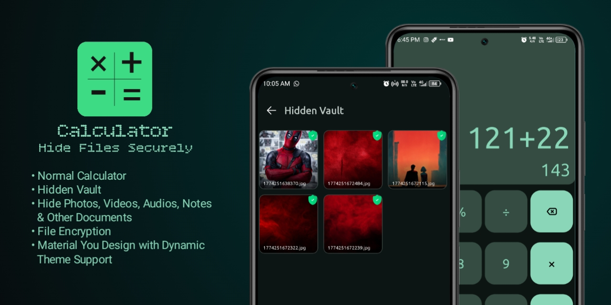

<div align="center">

# Calculator Hide File App for Android

<a href="https://github.com/Binondi/Calculator-Hide-Files/releases/latest">
      
</a>

<a href="https://github.com/Binondi/Calculator-Hide-Files/releases/latest">
  
</a>

<a href="LICENSE">
  
</a>


<br>
</div>
<div align="center"> 
         
<h4>Download</h4>

<a>[](https://github.com/binondi/Calculator-Hide-Files/releases) </a><a href="https://apt.izzysoft.de/fdroid/index/apk/devs.org.calculator"></a> <a href="https://www.androidfreeware.net/download-apk-devs-org-calculator.html">
[](https://www.openapk.net/calculator/devs.org.calculator/)
[](https://t.me/thecodebotog)
</a> 

</div>

## Why Choose This App?  
The **Calculator Hide File App** is an **open-source** application, allowing you to inspect the code yourself. This ensures **complete transparency** and guarantees that your **privacy remains uncompromised**.  


---

## About Calculator Hide File App

The **Calculator Hide File App** is an innovative **Android file-hiding app** that disguises itself as a **fully functional calculator**. It helps you **securely store** private files and protect them with a **hidden passcode**.

> **⭐ Why Choose This App?**  
> - Hide images, videos, documents & other files securely.  
> - Works like a **real calculator** with hidden storage mode.  
> - No one will suspect it’s a file vault!  
> - **Military-Grade Encryption** - Encrypt files with your own **custom key** using **AES-256-GCM**.  
> - **Disaster-Proof Recovery** - Encrypted files remain recoverable even after app uninstalls or device resets.
---

## Features

- **Dual Functionality** - A fully working scientific/standard **calculator** and a stealth **file vault** in one app.  
- **Secret Passcode Access** - Unlock your private vault by typing your secret passcode and pressing `=`.  
- **Advanced AES-256-GCM Encryption** - Industry-standard authenticated encryption with custom key derivation.  
- **Self-Contained File Metadata** - Original file names, extensions, and types are embedded directly inside the encrypted file header—no database dependency required for recovery.  
- **Disaster-Proof Reinstall Recovery** - Reinstalling the app or wiping data won't lose your files; simply re-enter your encryption key to restore full access and previews.  
- **Smart Migration Tool** - One-tap migration flow to automatically upgrade older encrypted files to the latest authenticated container format.  
- **Modern Material 3 Bottom Sheets** - Seamless UI for file options, folder management, encryption setup, and permission requests.  
- **Secure File Manager** - Hide, unhide, copy, move, and organize files into nested folders.  
- **Fast & Lightweight** - Optimized memory footprint and fluid performance across all Android devices.  
- **No Root Required** - Operates smoothly without rooting or custom system modifications.  

---

## 🔐 Advanced Encryption Architecture

The app incorporates a state-of-the-art cryptographic architecture designed for maximum security, zero-knowledge privacy, and foolproof disaster recovery:

### 1. Authenticated Encryption (AES-256-GCM)
- Utilizes **AES-256 in Galois/Counter Mode (GCM)**, providing both military-grade **confidentiality** and authenticated **data integrity**.
- Any tampering, byte corruption, or unauthorized alteration of encrypted files is detected and blocked before decryption.

### 2. High-Strength Key Derivation (PBKDF2)
- Encryption keys are derived from your custom passphrase using **PBKDF2WithHmacSHA256** with **100,000 iterations**.
- Every single file generates its own unique **16-byte cryptographic salt** and **12-byte initialization vector (GCM nonce)**, ensuring identical files never produce identical ciphertexts.

### 3. Self-Contained Binary Container (`CHFE`)
Unlike traditional vaults that rely solely on an internal SQLite/Room database to remember original filenames and formats, every encrypted file is structured as a standalone, self-describing binary package:
```text
+---------------------------------------------------------------------------------+
| Magic ("CHFE") | Ver (0x01) | Salt (16B) | IV (12B) | Encrypted Payload + Tag   |
+---------------------------------------------------------------------------------+
                                                       |
                                                       v
                                          +---------------------------------------+
                                          | Metadata Length (4B) | JSON Metadata  |
                                          | - Original Name & Extension           |
                                          | - MIME Type & File Size               |
                                          | - Timestamp                           |
                                          +---------------------------------------+
                                          | Plaintext File Data Content           |
                                          +---------------------------------------+
```
- **Zero-Database Loss**: Even if the app is uninstalled, cache cleared, or the database corrupted, the file retains its original name, extension, and data securely inside the encrypted payload.
- **Reinstall Recovery**: Upon reinstalling the app and entering your custom encryption key, all previews and file details are immediately restored.

### 4. Smart Reinstall Banner & File Indicators
- When encrypted files are present in a folder after reinstalling, the app prominently shows an alert banner below the toolbar: *"Set encryption key to see file previews"*.
- File cards display encrypted status badges and tap-to-unlock prompts until your master key is configured.

### 5. Safe & Atomic Legacy Migration
- Built-in migration engine detects legacy files and safely converts them to the new authenticated `CHFE` format.
- Uses atomic file operations (writes to `.tmp` first, verifies integrity, then replaces) to guarantee zero data loss even if the process is interrupted.
---

## Screenshots

<div align="center">
  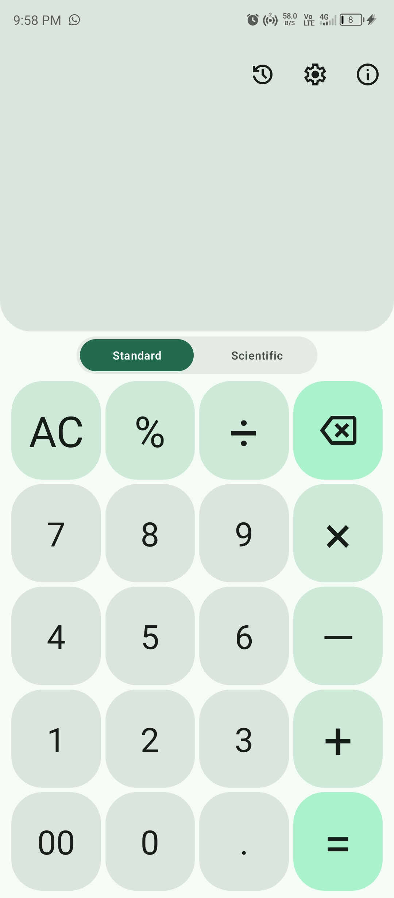
  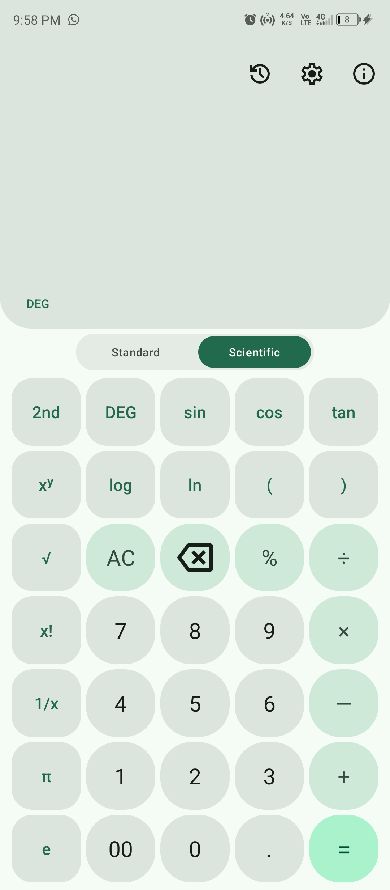
  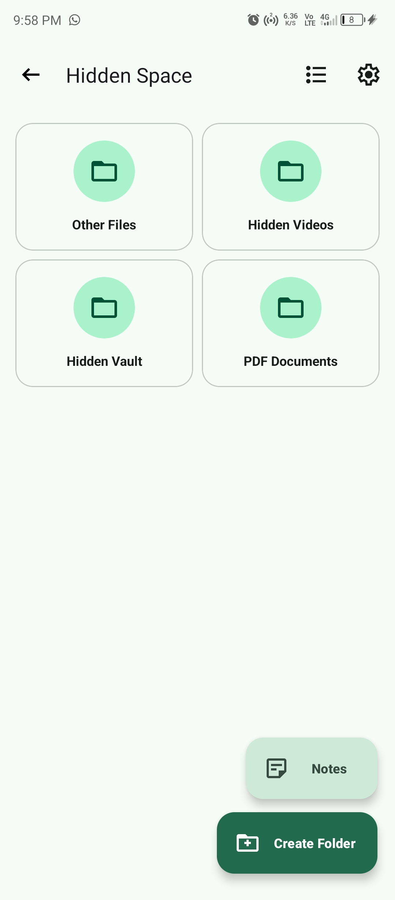
</div>

<div align="center">
  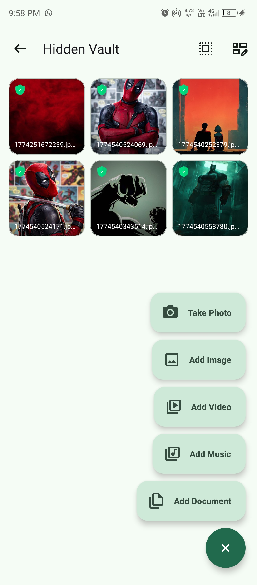
  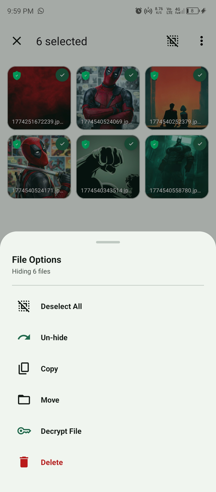
    
</div>

<div align="center">
    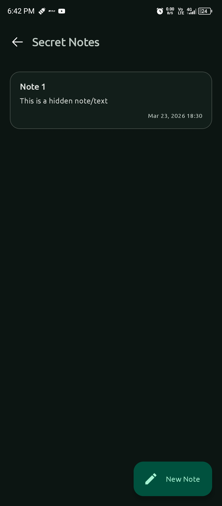
    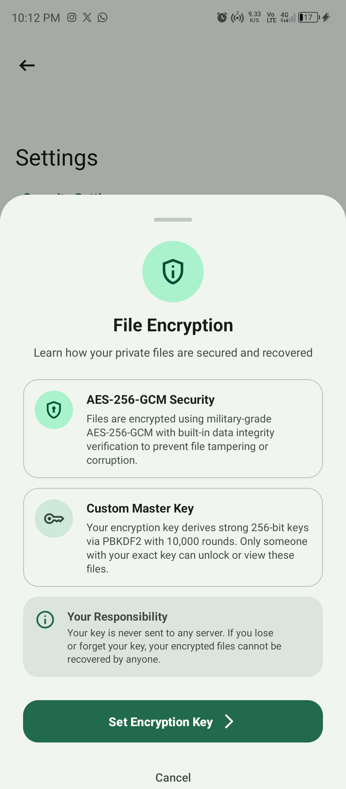
    
</div>

<div align="center">
    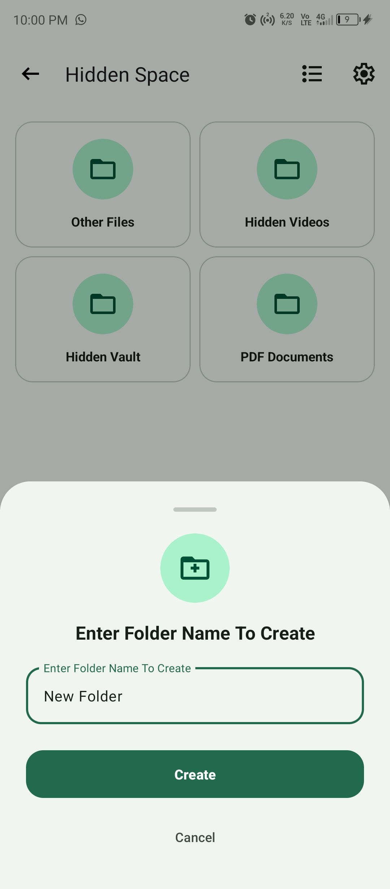
    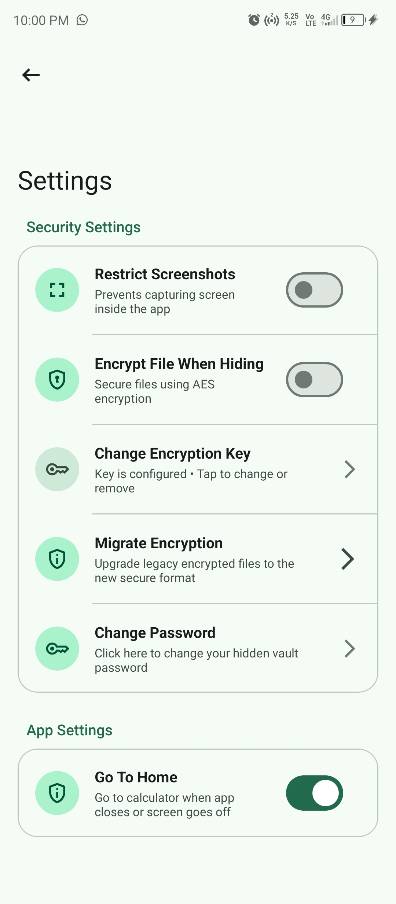
    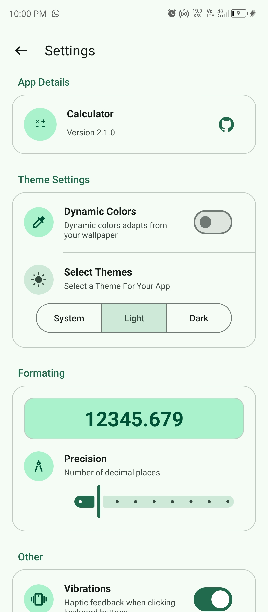
</div>

---

## How It Works

1. **Use as a Regular Calculator**  
   - Perform standard arithmetic operations like a normal calculator.  

2. **Enter Secret Passcode**  
   - Type `123456` and press `=` to set up your password.  
   - Enter your **custom passcode** and hit `=` to unlock the hidden file manager.  

3. **Manage Hidden Files**  
   - Add, remove, and restore hidden files.  
   - Files stay protected even after closing the app.
   - Create Hidden Folders.
   - Move & Copy Hidden Files Between Hidden Folders.

---

## Download & Installation

### **[Click to Download Latest Version](https://github.com/Binondi/Calculator-Hide-Files/releases/latest)**

### 🔹 Prerequisites
- **Android 8.0 or higher**  
- **Storage permissions enabled**
- **Require Manage All Files Permissons For Android 11 and Higher Versions.**

### 🔹 Installation Steps
```bash
git clone https://github.com/Binondi/Calculator-Hide-Files.git
```
- Open **Android Studio** and build the project.  
- Install the APK on your **Android device or emulator**.  

---

## Technologies Used

- **Programming Language**: Kotlin & Java
- **UI Framework & Architecture**: Material Design 3, ViewBinding, Android Jetpack, Room Database, Coroutines
- **Cryptography & Security**: AES-256-GCM, PBKDF2-HMAC-SHA256, Android KeyStore, Encrypted File Container (`CHFE`)
- **File Storage**: Secure internal app storage & MediaStore API  

---

## Why Use Calculator Hide File App?

- **No One Can Detect Your Files** - Works like a real calculator.  
- **100% Secure** - Your private files stay hidden, even if someone opens the app.  
- **Completely Free & Open Source** - Modify or contribute to the project.  

---

## ❤️ Support the Project

If you find this app useful, please consider supporting the development.

[](https://github.com/sponsors/Binondi)
[](https://paypal.me/BinondiBorthakur56)
[](https://buymeacoffee.com/binondi)

---

## Contributing

We welcome contributions! To contribute:

1. **Fork the repository**  
2. **Create a new branch**  
   ```bash
   git checkout -b feature-name
   ```
3. **Commit your changes**  
   ```bash
   git commit -m "Add a new feature"
   ```
4. **Push to GitHub**  
   ```bash
   git push origin feature-name
   ```
5. **Create a Pull Request**  

---

## License

This project is licensed under a **Custom Source-Available License**.  
- **Public & Transparent**: The source code is publicly viewable for privacy transparency and security auditing.  
- **Personal Use & Modification**: You are free to view, compile, and modify the app for your own private, personal use.  
- **No Unauthorized Distribution**: You may not publish, re-publish, or distribute the app (e.g. on app stores, websites, or APK download sites) without prior written permission from the author.  
- **No Commercial Use or Monetization**: Selling, renting, monetizing, or placing ads in the app or its code is strictly prohibited without authorization.  
- **Attribution & Feature Credit**: If you use any feature, algorithm, or portion of this project in another project, you must give prominent credit: *"This feature is implemented from Calculator Hide Files by Binondi Borthakur"*.

See the full license terms in the [LICENSE](LICENSE) file.  

---

## Contact

For any questions or feedback:  
**Email**: binondiborthakur56@gmail.com  
**GitHub**: [Binondi](https://github.com/Binondi)  

---

### ❤️ Thank You for Using Calculator Hide File App! ❤️
**Keep your files secure and hidden!**
